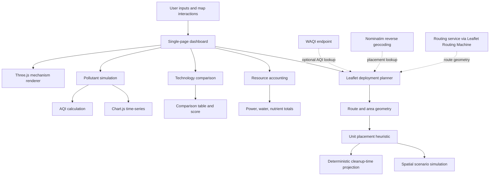
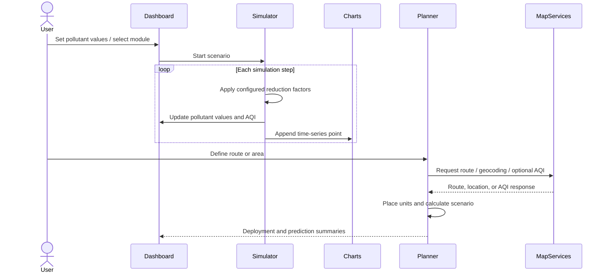
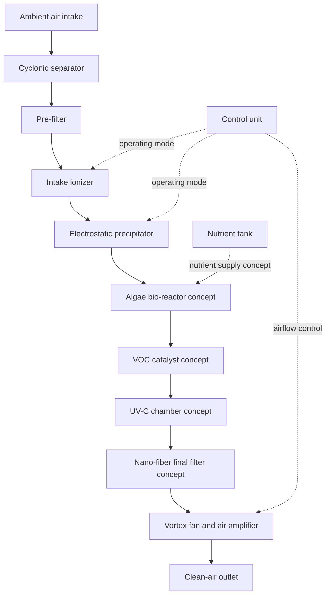

ALVORA — Algae-Based Air Purification & Deployment Simulator

<strong>An interactive research prototype for exploring multi-stage air
purification, pollutant dynamics, and geographically informed deployment
scenarios.</strong>

<em>Three.js · Chart.js · Leaflet · JavaScript · Mermaid</em>

<!--
  Replace the placeholders below with screenshots/GIFs captured from your running prototype.
  Suggested assets:
    assets/alvora-dashboard.png
    assets/alvora-3d-mechanism.gif
    assets/alvora-planner.png
-->

Research-prototype notice: ALVORA is currently a browser-based
simulation and planning prototype. Its displayed pollutant reductions,
component efficiencies, resource consumption, deployment estimates,
and cleanup-time predictions are model outputs or configured
assumptions—not experimentally validated device performance. The
planner contains a function named DL_Model, but the current
implementation is a deterministic numerical simulation, not a trained
deep-learning model.

Table of contents
- Overview
- What the prototype includes
- System architecture
- Purification architecture
- Interactive 3D mechanism
- Pollutant and AQI simulation
- Geographic deployment planner
- Cleanup-time prediction: what it really
  is
- Technology comparison
- Energy, water, and nutrient
  accounting
- Data provenance and validation
  status
- Technology stack
- Run locally
- Project structure
- Limitations and responsible
  interpretation
- Research and engineering roadmap
- Contributing
- Citation
- License
Overview
ALVORA is an interactive browser prototype for exploring a proposed
multi-stage air-purification concept that combines particulate capture,
electrostatic treatment, an algae-based bio-reactor concept,
gas-treatment stages, and airflow management.

The accompanying dashboard brings together several kinds of exploratory
tools:
1. A Three.js 3D representation of the proposed purification assembly.
2. A time-stepped pollutant simulation for PM2.5, PM10, NO₂, and VOCs.
3. AQI-oriented status displays and Chart.js time-series plots.
4. A configurable comparison of ALVORA, HEPA, plasma-ion, and
   activated-carbon archetypes.
5. Indicative coverage and resource-consumption calculators.
6. A Leaflet map planner for route- and area-based deployment
   scenarios.
The aim is to make the system concept, its assumptions, and its
deployment logic inspectable. It is not a claim that a production
purifier has been built, certified, or validated under controlled
environmental-chamber conditions.
What the prototype includes
Module	Implementation	What it is for
3D mechanism	Three.js r128 and OrbitControls	Inspect a procedural 3D representation of ALVORA and comparison devices
Component interaction	Three.js raycasting and HTML tooltips	Display component descriptions and configured efficiency labels
Pollutant simulation	JavaScript time-step updates	Explore configured pollutant decay scenarios
AQI display	PM2.5-based breakpoint interpolation in the current implementation	Provide a simplified AQI-oriented indicator
Time-series charts	Chart.js	Plot AQI and pollutant trajectories
Filter comparison	Hard-coded configuration objects and a weighted score	Compare configured technology assumptions
Coverage calculator	Deterministic area/AQI heuristic	Estimate a notional number of units
Resource dashboard	Rule-based power modes and accumulators	Illustrate energy, water, and nutrient accounting assumptions
Geographic planner	Leaflet, Leaflet Routing Machine, Nominatim, and WAQI request logic	Explore route/area placement and local scenario simulation
Architecture documentation	Mermaid	Describe the software and scenario-model flow

System architecture
The current application is a client-side HTML/CSS/JavaScript
application. It does not expose a backend service or a model-serving
API.

Runtime flow

The diagram represents logical responsibilities, not independently
deployed services. All core application logic currently runs in the
browser.
Purification architecture
The ALVORA 3D assembly is procedurally constructed from Three.js
geometry. The component labels below describe the intended conceptual
role represented in the prototype; they should not be read as verified
engineering specifications.

Conceptual stages
Stage / component	Role represented in the prototype
Cyclonic separator	Uses a rotating flow concept to separate heavier particulate matter
Pre-filter	Captures larger dust and pollen particles
Intake ionizer	Pre-charges incoming particles for the electrostatic stage
Electrostatic precipitator (ESP)	Uses charged collection plates to represent fine-particle capture
Algae bio-reactor	Represents a biological treatment stage; the current application does not simulate measured algal uptake kinetics
VOC catalyst	Represents a catalytic gas-treatment stage
UV-C chamber	Represents a UV-C treatment stage; no pathogen inactivation experiment is implemented
Nano-fiber filter	Represents a final particulate polishing stage
Vortex fan / air amplifier	Represents air movement and outlet distribution
Control unit	Visual placeholder for adaptive operating logic
Nutrient tank	Represents a nutrient supply subsystem for the bio-reactor concept

The 3D model is an explanatory visualization. Geometry, materials,
particle animations, and tooltip labels do not establish internal
dimensions, pressure drop, residence time, electrical safety, biological
viability, or filtration certification.
Interactive 3D mechanism
The mechanism view uses Three.js r128 with OrbitControls.
- Orbit, pan, and zoom around the model.
- Switch between ALVORA, HEPA, Plasma Ion, and Activated Carbon
  representations.
- Inspect supported components through raycast-driven tooltips.
- View animated pollutant and clean-air particles during the simulation.
- Observe visual operating-mode cues such as fan-speed changes and
  energy-mode indicators.
The models are created procedurally in JavaScript rather than loaded
from a CAD assembly or a validated engineering drawing.
Suggested visual assets for this README
Capture these from the running app and commit them under assets/:
File	Recommended capture
assets/alvora-dashboard.png	Full dashboard with the ALVORA mechanism selected
assets/alvora-3d-mechanism.gif	Short orbit/particle-animation capture
assets/alvora-components.png	Close-up showing the algae-reactor and filtration stages
assets/alvora-comparison.png	Technology comparison table
assets/alvora-planner.png	Leaflet route or area deployment view
assets/alvora-consumption.png	Energy and resource dashboard

Until these assets exist in the repository, the image paths above are
placeholders and will need to be replaced or removed.
Pollutant and AQI simulation
The main simulation accepts initial values for:
- PM2.5 in µg/m³
- PM10 in µg/m³
- NO₂ in µg/m³
- VOCs in ppb
- Simulation duration in minutes
The browser advances the simulation on a one-second JavaScript interval.
Each interval represents five simulated minutes in the UI.
Configured reduction factors
The current simulateStep() implementation applies fixed multiplicative
factors once per step:
Selected model	PM2.5 factor	PM10 factor	NO₂ factor	VOC factor
ALVORA	0.980	0.970	0.985	0.950
HEPA	0.985	0.970	1.000	1.000
Plasma Ion	0.990	0.985	0.998	0.998
Activated Carbon	1.000	1.000	0.980	0.970

For pollutant concentration (C), factor (r), and (n) simulation steps,
this part of the prototype behaves as:

\(C_n = C_0 r^n\)

This is a configured discrete-time decay rule. It is not derived from
measured clean-air delivery rate, chamber volume, residence-time
distribution, adsorption capacity, algal growth, or a validated
mass-balance model.
AQI implementation note
The main dashboard’s calculateAQI() function calculates the displayed
index from PM2.5 only. PM10 and NO₂ are accepted as inputs and
plotted, but they do not contribute to that dashboard AQI calculation.
The planner also maps AQI to a PM2.5 estimate and derives other
pollutant values using configured mix ratios.

Consequently:
- Treat the displayed AQI as a simplified PM2.5-derived indicator.
- Do not interpret it as a complete multi-pollutant regulatory AQI
  calculation.
- Do not use the displayed category for health decisions or regulatory
  reporting.
- Check the relevant jurisdiction’s official AQI method before making
  comparisons.
Chart.js renders the simulated AQI, PM2.5, PM10, NO₂, and VOC time
series. The chart visualizes model state; it is not a sensor feed.
Geographic deployment planner
The planner uses Leaflet to let a user define a route or rectangular
area and explore a hypothetical deployment of ALVORA units.
Route mode
1. Select Set Start and click the map.
2. Select Set End and click the map.
3. The routing integration obtains route geometry.
4. The planner estimates unit spacing along the route.
5. Candidate deployment points are checked using reverse-geocoding
   information where available.
Area mode
1. Select Area Mode.
2. Define the area using two map clicks.
3. The planner generates a grid of candidate unit positions.
4. Candidate positions are checked and marked on the map.
Scenario inputs and outputs
The planner supports:
- Live-AQI lookup mode or manually entered pollutant values.
- Wind speed and direction controls.
- User-added traffic and industrial pollution sources.
- Unit markers and approximate coverage circles.
- Unit-level pollutant/AQI displays.
- A mission log and play/pause simulation.
- Deployment, operational, financial, and cleanup-time summaries.
- A predicted pollutant-decay chart.
The configured traffic source adds NO₂ at 0.5 model units per minute
and the industrial source adds PM2.5 at 1.0 model units per minute to
a nearby unit. These are scenario parameters in the source code, not
emission factors measured at a deployment site.
External map and data services
The planner references:
- Leaflet Routing Machine for route planning.
- Nominatim for reverse-geocoding / placement-context checks.
- WAQI API for an optional AQI lookup.
The code currently contains a demo WAQI token placeholder. A working
API token may be required for live data. Respect each provider’s terms,
attribution requirements, rate limits, and usage policies before public
deployment. Nominatim should not be treated as a high-volume production
geospatial validation service.
Deployment assumptions
The current planner configuration includes:
Parameter	Prototype setting
Unit CADR	800 m³/h
Unit base radius	75 m
Effective height	3 m
Target AQI	50
Unit power	150 W
Water consumption	20 mL/h
Nutrient consumption	5 mL/h
PM2.5 removal efficiency	0.995
PM10 removal efficiency	0.990
NO₂ removal efficiency	0.700
VOC removal efficiency	0.950

These values are hard-coded model inputs. They are not accompanied in
the current prototype by calibration records, laboratory reports,
uncertainty intervals, or field validation. They must therefore be
labelled assumed/configured when used in a report or presentation.
Cleanup-time prediction: what it really is
The planner defines an object named DL_Model, and the interface
currently logs messages such as “Running Deep Learning prediction
model.” However, the implementation in predictCleanupTime() is not a
trained deep-learning model.

It is a deterministic iterative calculation:
1. Copy the initial pollutant concentrations.
2. Calculate a per-unit volume from the configured base radius and
   effective height.
3. Calculate total modeled CADR from the number of deployed units.
4. Calculate air turnovers per minute.
5. Apply configured pollutant-specific removal fractions iteratively.
6. Recalculate the PM2.5-derived AQI after each simulated minute.
7. Stop when the target AQI is reached or the 5,000-iteration guard is
   triggered.
8. Return the predicted time and a pollutant history for plotting.
The core calculation is conceptually represented as:

\(V\_{} = r^2 h\)

\(Q\_{} = N\)

\(T\_{} =\)

\(C\_{p,t+1} = C\_{p,t} (1 - T\_{} \_p)\)

where (N) is the number of deployed units and (_p) is the configured
removal-efficiency parameter for pollutant (p).

This is a simplified idealized model. The prediction loop does not
currently include the planner’s wind transport, active pollution
sources, spatial mixing, or placement failures. It therefore represents
an idealized cleanup-time projection, not a field forecast.
Why it should not be called deep learning
A trained deep-learning model would require, at minimum:
- A defined prediction target and input schema.
- A representative, documented training dataset.
- A model architecture and training procedure.
- Train/validation/test separation.
- Evaluation against baselines and held-out observations.
- Error metrics, uncertainty characterization, and reproducible model
  artifacts.
- Independent validation on conditions not used during development.
None of those elements is implemented by the current DL_Model
function. The name is retained here only to explain the existing code.
For technical accuracy, refer to it in research documentation as the
deterministic cleanup-time estimator or iterative scenario model
until a genuinely trained model is developed and evaluated.
Technology comparison
The comparison panel includes four configured technology archetypes:
- ALVORA
- HEPA
- Plasma Ion
- Activated Carbon
The current comparison data is stored in a hard-coded filterData
array. It includes pollutant-efficiency assumptions, initial cost,
annual maintenance cost, annual energy cost, and a lifespan label.

The ten-year cost is calculated as:

\(\_{10y} =  + 10  + 10\)

A weighted effectiveness score is then calculated from the configured
pollutant efficiencies and cost. The selected pollutant receives a
larger weight than the other pollutants.

Important: These values are prototype configuration data. The
current HTML does not provide traceable citations, test conditions,
product model numbers, or source-level evidence for each comparison
entry. The UI’s generic statement that the data is synthesized from
reputable sources is not a substitute for a source register. Do not
present the ranking, “winner,” costs, or efficiencies as independently
verified market or laboratory findings without adding evidence.

A defensible future comparison should document, for every technology:
- Exact device / filter class and operating conditions.
- Particle size and gas species tested.
- Inlet concentration, airflow, and test duration.
- Single-pass efficiency versus room-level removal.
- Pressure drop and clean-air delivery rate.
- Ozone or by-product measurements where relevant.
- Replacement intervals and lifecycle assumptions.
- Currency, geography, energy tariff, and cost year.
- Primary source or test report.
Energy, water, and nutrient accounting
The consumption panel is an illustrative accumulator driven by a
rule-based power mode:
AQI condition	Mode	Power draw
AQI > 200	Boost	120 W
AQI < 100	Eco	25 W
Otherwise	Normal	50 W

At each main simulation step, the UI accumulates:
- Energy using the selected power draw and a five-minute simulated
  interval.
- Water using a configured increment proportional to power draw.
- Nutrients using a configured increment proportional to power draw.
These displayed totals are not connected to physical meters, pumps, flow
sensors, or measured nutrient dosing. The planner separately defines
nominal unit resource rates of 150 W, 20 mL water/hour, and 5 mL
nutrient/hour for its operational calculations. The dashboard and
planner therefore use distinct configured assumptions; they should not
be conflated as one calibrated resource model.

Before engineering or sustainability claims are made, replace these
assumptions with measured power profiles, water-flow measurements,
nutrient dosing logs, and clearly specified operating hours.
Data provenance and validation status
ALVORA deliberately separates what the code simulates from what
has been experimentally demonstrated.
Quantity / claim	Current status in this prototype	Evidence needed for validation
PM2.5 / PM10 / NO₂ / VOC trajectories	Simulated from fixed reduction factors or scenario rules	Calibrated sensors and controlled inlet/outlet measurements
AQI	Computed from PM2.5 using the code’s simplified breakpoint logic	Correct jurisdiction-specific method and validated pollutant observations
Component efficiencies	Hard-coded assumptions / tooltip labels	Component-level laboratory test reports with stated conditions
Algae pollutant uptake	Conceptual stage in 3D model; no biological uptake kinetics implemented	Species, culture conditions, gas transfer, uptake-rate and stability experiments
UV-C pathogen treatment	Conceptual visualization and label	Validated dose, exposure, organism-specific log-reduction tests, and safety review
CADR and coverage radius	Configured planner inputs	Standardized CADR test and field dispersion/coverage study
Cleanup time	Deterministic idealized calculation	Comparison with measured time-series under controlled and field conditions
Geographic placement	Map-service-assisted heuristic	Site survey, geospatial validation, access and safety review
Energy / water / nutrients	Rule-based estimates	Metered energy, flow, and dosing data
Technology comparison	Hard-coded values and proprietary score formula	Traceable sources, consistent test protocols, and reproducible lifecycle-cost assumptions

Recommended reporting language
Use language such as:
- “The prototype simulates a reduction in PM2.5 under configured decay
  assumptions.”
- “The planner estimates candidate deployment locations using a
  geometric spacing heuristic.”
- “The cleanup-time output is generated by a deterministic iterative
  model.”
- “The 3D view illustrates the proposed purification stages.”
Avoid claims such as:
- “ALVORA removes 99% of VOCs” unless validated under a defined test
  protocol.
- “The AI predicts air quality” when describing the current
  deterministic estimator.
- “The system cleans a given area in two hours” without validated CADR
  and field evidence.
- “The technology outperforms HEPA” based only on the current hard-coded
  comparison table.
Technology stack
Technology	Role
HTML5	Application structure
CSS and Tailwind CSS CDN	Styling and responsive layout
Vanilla JavaScript	UI state, simulation, calculations, and interactions
Three.js r128	Procedural 3D models and particle visualization
Three.js OrbitControls	3D camera interaction
Chart.js	AQI, pollutant, coverage, power, and prediction charts
Leaflet	Interactive geographic map
Leaflet Routing Machine	Route geometry and routing UI
Nominatim	Reverse-geocoding lookup
WAQI API	Optional AQI lookup

The current prototype loads its libraries from public CDNs and does not
require a Node.js build step.
Run locally
Requirements
- A modern desktop browser with WebGL support.
- Python 3 (or another local static HTTP server).
- Internet access for CDN assets and the map / routing / geocoding
  integrations.
1. Clone the repository
git clone https://github.com/<your-username>/<your-repository>.git
cd <your-repository>
2. Add the application file
Place the provided application HTML at the repository root and name it
index.html:
alvora/
├── index.html
├── README.md
└── assets/
3. Start a local server
python -m http.server 8000
4. Open the application
Visit:
http://localhost:8000
Opening the file directly with file:// may work for some dashboard
functions, but a local HTTP server is recommended for consistent browser
behavior and external service requests.
5. Configure live AQI access (optional)
The planner currently contains a placeholder WAQI token. If you have
permission to use the service, configure a valid token in the planner’s
CONFIG.api.waqiToken value. Avoid committing private API tokens to a
public repository. For a public deployment, move secrets behind a
server-side endpoint rather than embedding them in client-side
JavaScript.
Project structure
The supplied artifact is currently a single-file application. A
maintainable future structure could be:
alvora/
├── index.html
├── README.md
├── assets/
│   ├── alvora-dashboard.png
│   ├── alvora-3d-mechanism.gif
│   ├── alvora-components.png
│   ├── alvora-comparison.png
│   └── alvora-planner.png
├── src/
│   ├── main.js
│   ├── visualization/
│   │   ├── scene.js
│   │   ├── alvora-model.js
│   │   └── particle-system.js
│   ├── simulation/
│   │   ├── pollutant-model.js
│   │   ├── aqi.js
│   │   └── resource-model.js
│   ├── comparison/
│   │   └── technology-data.js
│   └── planner/
│       ├── map.js
│       ├── deployment.js
│       └── cleanup-estimator.js
└── docs/
    ├── model-assumptions.md
    ├── validation-protocol.md
    └── data-sources.md
This is a suggested refactoring layout, not the current repository
layout.
Limitations and responsible interpretation
The current implementation has several important constraints:
1. No trained ML model: DL_Model.predictCleanupTime() is
   deterministic iterative code.
2. Simplified AQI: the main dashboard derives AQI from PM2.5 alone.
3. Configured pollutant decay: reduction factors are constants, not
   empirically fitted kinetics.
4. Conceptual biological stage: the algae reactor is visualized,
   but algal growth, CO₂ uptake, NO₂ uptake, nutrient limitation, and
   mass transfer are not mechanistically simulated.
5. No sensor integration: dashboard readings are user inputs and
   simulated values; they are not measurements from deployed sensors.
6. Unverified efficiency and cost table: comparison values need
   traceable sources and matched test conditions.
7. Simplified spatial model: wind transport and source additions
   are heuristic; urban dispersion, turbulence, boundary-layer
   dynamics, and complex terrain are not represented.
8. External service dependency: routing, reverse geocoding, and
   live AQI depend on external services and their availability and
   usage policies.
9. Resource totals are estimates: the current dashboard uses
   configured increments rather than physical measurements.
10. No validation package included: the supplied artifact does not
    include laboratory reports, calibration files, field datasets, or
    statistical validation results.
The application is intended for visualization, hypothesis exploration,
and prototype development. It is not an environmental monitoring
instrument, certified purifier, medical device, or substitute for
official air-quality information.
Research and engineering roadmap
The following roadmap would help move the prototype toward a
reproducible research and engineering platform.
Model and simulation
- [ ] Separate simulation code from UI and visualization code.
- [ ] Define pollutant units, state variables, boundary conditions, and
  mass-balance assumptions.
- [ ] Replace fixed per-step factors with a documented model tied to
  CADR, volume, airflow, and pollutant-specific removal.
- [ ] Add source terms, deposition, ventilation, mixing, and uncertainty
  parameters.
- [ ] Use a jurisdiction-specific AQI implementation and test it against
  published reference examples.
- [ ] Add unit tests for concentration updates, AQI breakpoints,
  resource calculations, and stopping conditions.
Experimental validation
- [ ] Define a controlled test chamber and measurement protocol.
- [ ] Record inlet and outlet concentrations using calibrated
  instruments.
- [ ] Measure airflow, CADR, pressure drop, power draw, water use, and
  nutrient dosing.
- [ ] Test each purification stage independently before testing the
  integrated system.
- [ ] Characterize algae species, culture conditions, growth, gas
  transfer, uptake, and long-term stability.
- [ ] Evaluate ozone and other possible by-products for ionization /
  plasma-related stages.
- [ ] Publish raw data, calibration metadata, uncertainty, and
  repeatability results.
Prediction research
- [ ] Establish a dataset from repeated controlled experiments and
  carefully documented field trials.
- [ ] Define prediction targets (for example, time to a specified PM2.5
  threshold).
- [ ] Build transparent deterministic baselines before training ML
  models.
- [ ] If deep learning is justified by data volume and task complexity,
  document architecture, training, validation, and test procedures.
- [ ] Compare ML against physical / empirical baselines using held-out
  scenarios.
- [ ] Report MAE, RMSE, calibration, uncertainty intervals, and
  generalization limits.
Product and deployment engineering
- [ ] Validate unit placement against site access, electrical supply,
  maintenance, and safety constraints.
- [ ] Add robust handling for failed or rate-limited map-service
  requests.
- [ ] Move API credentials out of browser code.
- [ ] Record data-source timestamps and provenance in the UI.
- [ ] Version every model parameter set and comparison dataset.
- [ ] Add reproducible scenario exports.
Contributing
Contributions are welcome, especially in:
- Simulation correctness and unit testing.
- AQI methodology and pollutant data provenance.
- 3D model clarity and accessibility.
- Geospatial deployment algorithms.
- Experimental protocol design and validation.
- Documentation and reproducibility.
For substantial changes, open an issue describing the problem,
assumptions, and proposed approach before submitting a pull request.
Please label simulated assumptions clearly and do not introduce
experimental-performance claims without supporting evidence.
Citation
If you use ALVORA in a report, presentation, or research discussion,
cite the repository and identify the exact version or commit used. A
citation record can be added once the authorship, institutional
affiliation, and repository DOI are finalized.

Suggested placeholder:
ALVORA: Algae-Based Air Purification and Deployment Simulator.
Authors: <author names>.
Version: <release or commit>.
Repository: <repository URL>.
Year: <year>.
License
No license file was included with the supplied HTML artifact. Until a
license is selected and added to the repository, reuse and
redistribution permissions are not explicitly granted. Add a LICENSE
file before inviting external contributions or distributing the project
as open source.
